# Removing Glasses from Video at Any Head Angle

**A frame-segmentation network trained only on synthetic data, plugged into a ProPainter video-inpainting pipeline that runs locally on a Mac.**

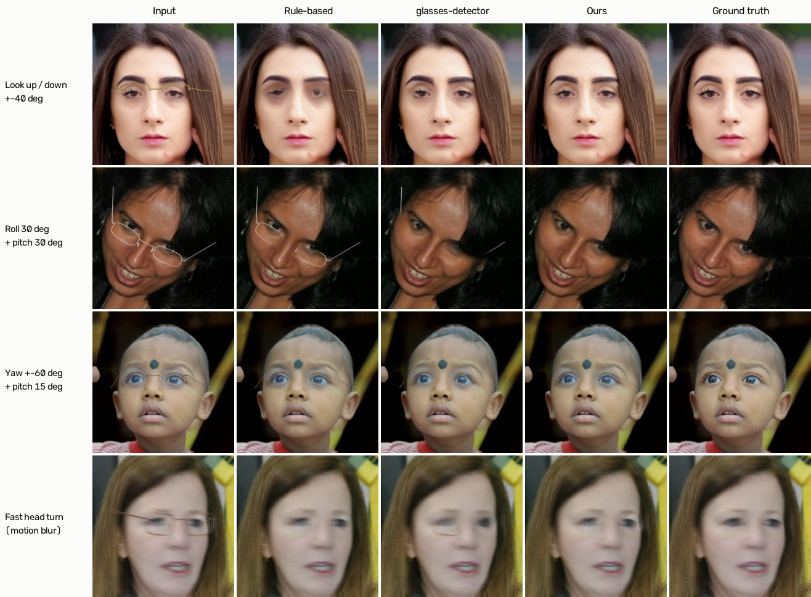

*Each row is one frame from a synthetic test clip with a known glasses-free ground truth. The rule-based pipeline and the open-source
[glasses-detector](https://github.com/mantasu/glasses-detector) model leave frame fragments behind when the head pitches, rolls or turns; this project's mask removes them.
Faces: FFHQ ([Karras et al. 2019](#references)), re-posed with LivePortrait.*

---

## TL;DR

- **Problem.** Removing eyeglasses from video is mostly a *masking* problem: a good video inpainter (ProPainter) can fill thin regions well, but only if it is told exactly where the frame is. Face-parsing masks fall apart when the head looks up or down, tilts, turns, or is small and blurry.
- **Approach.** Train a dedicated **frame-only segmentation network** (frame, bridge, nose pads, hinges, visible temples; lens interior untouched) on **synthetic data only**: 55k public no-glasses faces, re-posed with LivePortrait and mesh re-projection, with **procedurally rendered 3D glasses** that give pixel-exact labels. No manual annotation.
- **Result (end-to-end, 11 synthetic test scenes with ground truth).** Frames that still show glasses after removal: **16%** with this model vs. **46%** with glasses-detector and **63%** with the original rule-based mask, at a comparable mask area. The largest gaps are exactly the hard cases: looking up/down ±40° (4% vs. 38% vs. 98%), roll 30° + pitch 30° (0% vs. 87% vs. 81%).
- **Independent check on hard poses.** On Microsoft's Face Synthetics (someone else's renderer, exact frame labels), on 454 clear-lens images with large pitch, yaw, roll or combinations: boundary F1 **0.86** vs. 0.77 (take-off-eyeglasses), 0.72 (glasses-detector) and 0.58 (rule-based); the 95% bootstrap interval of every gap excludes zero (§5.4).
- **Honest caveats.** The end-to-end benchmark is rendered by this project's own synthesizer (home advantage). On near-frontal Face Synthetics faces take-off-eyeglasses is slightly more accurate (0.93 vs. 0.92). On clean, near-frontal **real** photos glasses-detector still has higher outline recall (0.94 vs. 0.90 F); about half of that gap is mask thickness, the other half is genuine misses. Tiny faces (30–60 px) remain hard for every method.

| | Ours | glasses-detector (medium) | Rule-based | take-off-eyeglasses |
|---|---|---|---|---|
| End-to-end residue rate (synthetic videos, ↓) | **16%** | 46% | 63% | – |
| Real photos, F, original / roll ±30° (↑) | 0.90 / 0.88 | **0.94 / 0.91** | 0.88 / 0.74 | 0.83 / 0.62 |
| Real photos, F, tiny face / motion blur (↑) | **0.83** / 0.82 | 0.67 / 0.82 | 0.61 / 0.81 | 0.12 / 0.44 |
| False-positive area on faces without glasses (↓) | 0.11% | 2.50% | **0.01%** | 0.08% |
| Face Synthetics (third party), boundary F1, near frontal / 454 hard poses (↑) | 0.92 / **0.86** | 0.79 / 0.72 | 0.64 / 0.58 | **0.93** / 0.77 |

---

## 1. Why the mask is the bottleneck

The starting point was a working local pipeline:


Step **D** originally came from a face-parsing model (BiSeNet trained on CelebAMask-HQ's `eye_g` class) plus hand-written rules that measured rim thickness along the parsed outline and looked for hinge and temple lines. It worked on frontal close-ups and broke on everything else: face parsers are trained mostly on frontal portraits, and every rule was tuned on them.

Two design decisions follow from the use case:

1. **Segment the frame, not the glasses.** The parsing class covers the whole glasses including the lenses. Inpainting the lens region means re-drawing the eyes, which changes identity and blinks. This project only masks what physically occludes skin — rims, bridge, pads, hinges, visible temples — and keeps the lens interior.
2. **Optimise for the hard cases first.** Multi-camera footage contains people looking down at a phone, filmed from a high or low camera, turning and tilting at the same time, sometimes only 40 px tall. Combined poses (roll + pitch, yaw + pitch, all three) are where existing tools fail, so the training distribution is built around them.

ProPainter ([Zhou et al. 2023](#references)) is kept as the inpainter. With thin masks (3–5% of the face crop) surrounded by real skin, propagation from neighbouring frames already does most of the work; the evaluation in §5 shows that residue tracks mask quality much more than inpainting quality.

## 2. Training data without a single manual label

### 2.1 A pool of glasses-free faces

Public datasets, filtered automatically (BiSeNet glasses-area check, FaceMesh/RetinaFace landmark consistency, HeadPose cross-check):

| Source | Kept | Notes |
|---|---|---|
| FFHQ 512 px, first 16 shards | 14,920 | 4,595 glasses wearers removed |
| CelebAMask-HQ | 27,019 | |
| AFLW2000-3D | 1,208 | large poses |
| Talking-head sample clips | 431 | smoke tests |
| **LivePortrait re-posed** | 5,289 | from the faces above |
| **Mesh re-projected** | 5,731 | some chained on LivePortrait output |

Public face datasets are overwhelmingly frontal. Only 59% of the pitch × yaw target grid (±50° × ±70°, 10° cells) had any sample at all.

### 2.2 Re-posing faces

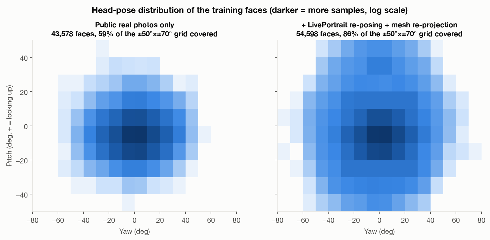

- **LivePortrait re-posing** ([Guo et al. 2024](#references)): the implicit-keypoint rotation is edited directly to reach a target pitch/yaw. Measured on this setup, LivePortrait's pitch has the opposite sign to the HeadPose estimator and a gain of about −0.86; single-axis targets up to pitch ±40° / yaw ±60° are reachable. About half of the renders survive the quality checks.
- **Mesh re-projection** (the "face profiling" idea behind 300W-LP, [Zhu et al. 2016](#references)): rotate the MediaPipe FaceMesh ([Kartynnik et al. 2019](#references)) in 3D, warp the texture per triangle, fill the holes the mesh has at the eyes and mouth, extrapolate hair and ears with a thin-plate spline driven by virtual "skull rings", and mark newly revealed regions as uncertain (down-weighted in the loss). Clean up to ±20°, so it is used for extra rotation on top of other samples.
- **Roll** is a 2D rotation and is applied exactly at training time (±45°), followed by the same crop the pipeline uses.
- **Targeted filling**: sparse pitch × yaw cells are filled on purpose by combining methods (LivePortrait to a moderate angle, then re-projection on top).

Coverage rose to **86%** of the grid; 1,264 samples have two axes beyond 25°, 121 have all three. The four extreme corners (|yaw| > 50° *and* |pitch| > 30°) stayed empty: there, both re-posing methods produce melted hair or floating glasses, and the landmark checks themselves become unreliable, so those samples were rejected rather than trusted.

### 2.3 A parametric 3D glasses renderer

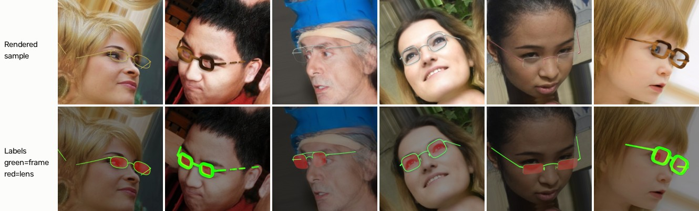

Glasses are built in a face-local frame defined by FaceMesh landmarks (origin between the eyes, X along the eye line, unit = outer-eye distance) and rendered in about 9 ms per sample on one CPU core:

- **Geometry**: superellipse lenses with cat-eye and aviator variants, tilt and wrap, single or double bridge, nose pads on metal frames, hinges, straight temples that are pushed outside the head and end above the ear. Styles: full rim, half rim with a nylon thread, rimless, thick acetate (with visible side thickness).
- **Occlusion**: a z-buffer rasterised from the FaceMesh triangles hides the far temple and the far rim behind the nose in profile; temples are hidden under hair with 50% probability.
- **Materials**: metal (gold, silver, gunmetal, black, rose gold) with highlight and dark edge lines and specular glints; acetate (black, brown, tortoise texture, transparent, coloured) with soft shading; cast shadows on skin; lens refraction, tint and reflections inside the lens only.
- **Labels**: soft coverage maps for the frame and the lens interior. Faint rimless edges and nylon threads are labelled according to how visible they actually are.

A few things that looked right in frontal previews but were wrong in profile and were only caught by rendering pose grids: the frame being pushed 1–2 cm forward because the nose was included in the "do not penetrate the face" check (invisible frontally, floating glasses at 60° yaw); oversized lenses cutting into the nose wings; temples bending into staircases.

### 2.4 Degradations

Every sample is drawn from a pose policy (50% uniform over the full range, 30% single-axis extremes, 20% combined extremes), then degraded: 50% are downscaled 1.5–7× and upscaled again to imitate tiny faces, plus motion blur, JPEG / H.264-like blocking, noise, low light, back light, interlacing, wide-angle distortion and camera-height offsets. 10% of samples have no glasses at all.

## 3. Model and training

- **Network**: U-Net with an ImageNet-pretrained ResNet-34 encoder from `timm`, decoded to full resolution with a shallow full-resolution branch, because frames can be 1–3 px wide. Two outputs: frame and lens (auxiliary). 24.5 M parameters; about 17 ms per 384 × 384 frame on an Apple M5 GPU.
- **Loss**: BCE (positive weight 6) + soft Dice for the frame, 0.3 × (BCE + Dice) for the lens, per-pixel weights for uncertain regions.
- **Training**: 30k steps, batch 12 at 384 px, AdamW, cosine schedule, fp16 autocast on MPS; about 5 hours on a MacBook with an M5 chip. Training data is synthesized on the fly by 7 worker processes.
- **Validation**: 1,000 fixed synthetic samples from held-out identities. Best boundary F1 (2 px tolerance) **0.822** at step 18k. Pose is no longer the weak spot; tiny faces and rimless frames are:

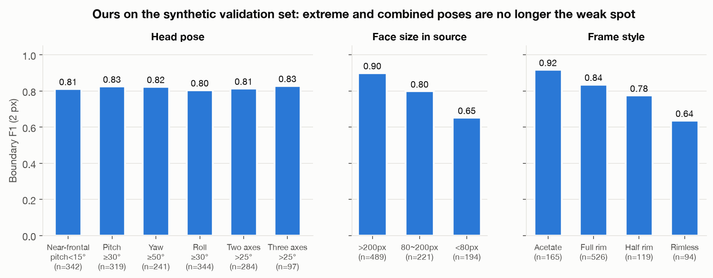

### Engineering notes

- The HeadPose model's pitch sign is the opposite of its documentation (positive = looking up); verified by rotating images and against FaceMesh geometry before any pose sampling was written.
- FaceMesh's presence score is saturated near 1.0 and useless as a quality filter. Landmarks were validated by comparing five derived points to RetinaFace keypoints and by checking mesh-derived pose against HeadPose.
- Mirror padding around a face crop creates mirrored "faces" that detectors happily pick; replicate padding or extra margin was used instead.
- On Apple MPS, feeding a non-contiguous tensor (from a channel swap plus permute) made the first convolution's backward pass about 4× slower: 1.14 s → 0.29 s per step after a single `.contiguous()`.
- onnxruntime opens one thread per core per session by default; six worker processes pushed the load average to 65. Limiting each session to one thread fixed throughput.
- LivePortrait's warping module runs in fp32 on MPS (1.5 s per frame); fp16 autocast brings it to 0.3 s with < 0.1% output difference.

## 4. What it is compared against

| Method | What is used | Licence |
|---|---|---|
| **Ours** | this repository | code MIT, weights CC BY-NC-SA 4.0 |
| **Rule-based** | the original pipeline's mask (BiSeNet + line detection) | – |
| **glasses-detector** ([mantasu/glasses-detector](https://github.com/mantasu/glasses-detector)) | `GlassesSegmenter(kind="frames")`, sizes `small` (TinySegNet) and `medium` (LR-ASPP MobileNetV3), authors' released weights | MIT |
| **take-off-eyeglasses** ([Lyu et al. 2022](#references), [StoryMY/take-off-eyeglasses](https://github.com/StoryMY/take-off-eyeglasses)) | the eyeglasses-mask branch only, authors' released checkpoint | no licence file; evaluated locally, not redistributed |

All baselines use the authors' released weights without retraining, and every method receives the same input: the pipeline's 512 px face crop. A pixel counts as frame if probability > 0.5.

## 5. Results

### 5.1 End to end: does the final video still show glasses?

Eleven scene types, one clip each, rendered with a fixed pair of glasses per clip on held-out FFHQ identities, with the glasses-free clip as ground truth (`training/make_test_videos.py`). The same pipeline (ProPainter, residue check and rework) runs with each mask source.

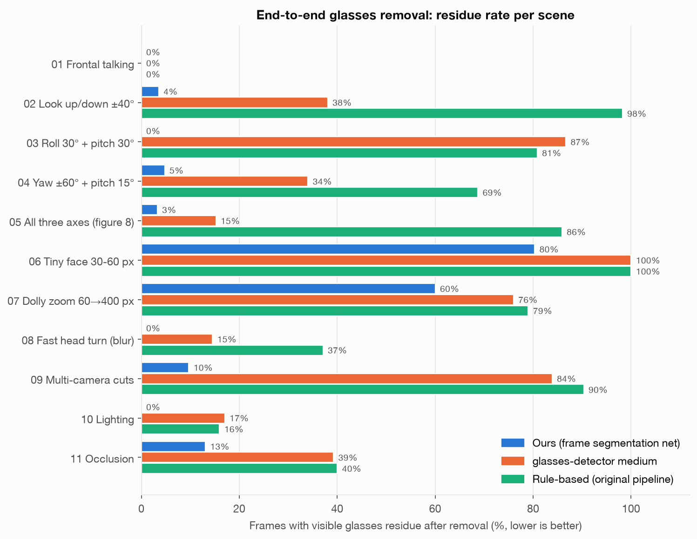

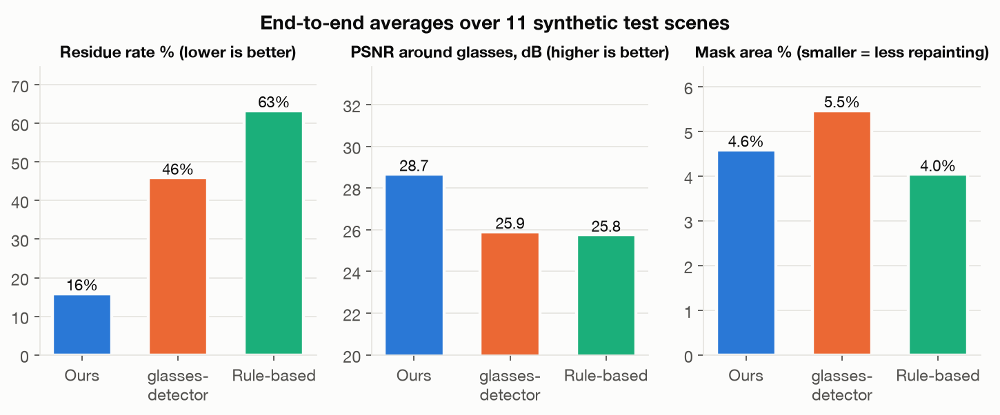

| Scene | Rule-based | glasses-detector | **Ours** |
|---|---|---|---|
| 01 Frontal talking | 0% | 0% | 0% |
| 02 Look up / down ±40° | 98% | 38% | **4%** |
| 03 Roll 30° + pitch 30° | 81% | 87% | **0%** |
| 04 Yaw ±60° + pitch 15° | 69% | 34% | **5%** |
| 05 All three axes | 86% | 15% | **3%** |
| 06 Tiny face 30–60 px | 100% | 100% | **80%** |
| 07 Dolly zoom 60 → 400 px | 79% | 76% | **60%** |
| 08 Fast head turn | 37% | 15% | **0%** |
| 09 Multi-camera cuts | 90% | 84% | **10%** |
| 10 Lighting | 16% | 17% | **0%** |
| 11 Occlusion | 40% | 39% | **13%** |
| **Average** (PSNR around the glasses) | 63% (25.8 dB) | 46% (25.9 dB) | **16% (28.7 dB)** |

A frame counts as residue when more than 20% of its ground-truth frame pixels still differ from the clean frame (ΔE > 20 in Lab).

*Caveat:* these clips are rendered by the same synthesizer the model was trained on, so this is a favourable benchmark for it.

### 5.2 Per-frame segmentation

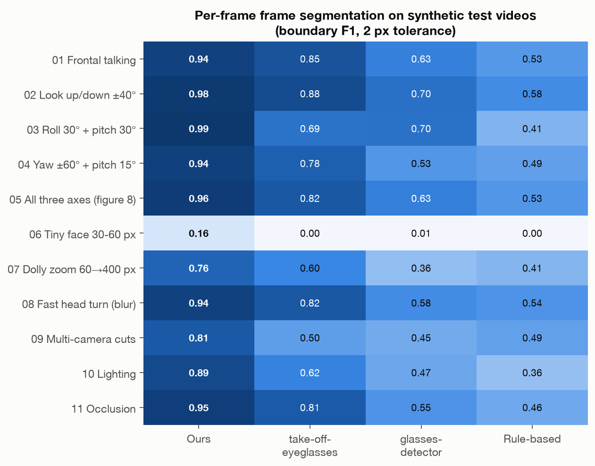

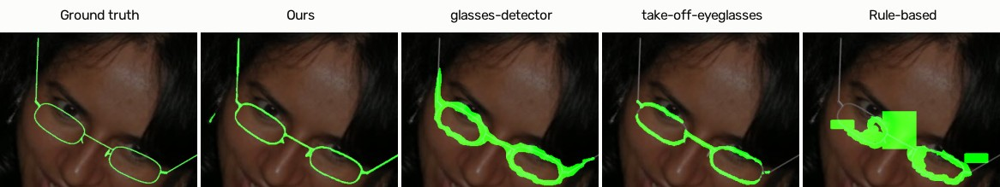

The mask comparison shows the qualitative difference behind the numbers: this model traces the frame and temples as thin lines; glasses-detector produces a thick band that also covers part of the lens; the take-off-eyeglasses mask breaks up at this pose; the rule-based mask is blocky and misses the far temple.

### 5.3 Real photos

1,415 real CelebAMask-HQ photos with glasses ([Lee et al. 2020](#references)) and 500 without. No glasses wearer was ever used for training, so these are unseen people for this model as well. The `eye_g` annotation covers the whole glasses including the lenses and is coarse, so the metric is precision (prediction inside `eye_g`) against recall of the `eye_g` outline (≈ the outer edge of the frame), 6 px tolerance. Identical perturbations are applied for every method.

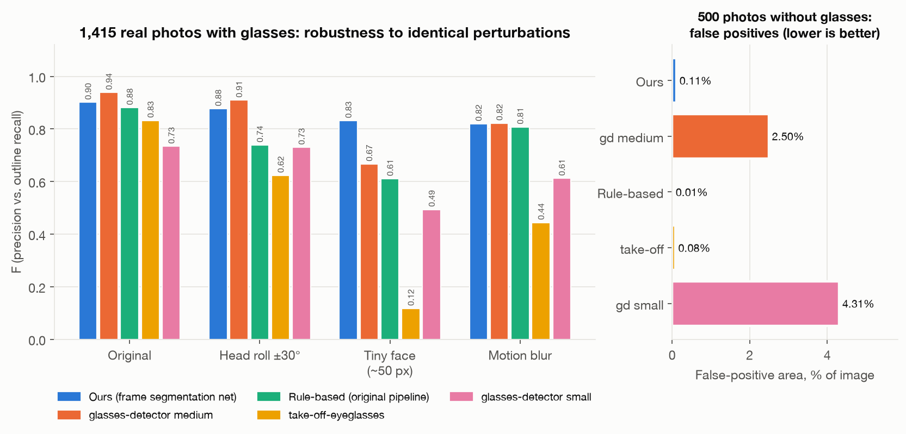

- **glasses-detector medium is the strongest baseline** and is better on clean near-frontal photos and under roll.
- Part of that gap is mask thickness: dilating this model's prediction by 4 px (what the pipeline does anyway) raises F from 0.901 to 0.915 and recall from 0.85 to 0.89; glasses-detector sits at 0.939 / 0.95. The remaining recall gap is real: thin real frames are occasionally missed, which shows up as short leftover segments in real videos.
- This model is clearly ahead on **tiny faces** (0.83 vs. 0.67) and has **~23× fewer false positives** on faces without glasses (0.11% vs. 2.5% of the image), which matters for video where many frames and many people have no glasses.

CelebAMask-HQ is almost entirely near frontal: by HeadPose estimate only 4 of the 1,415 photos look up or down by more than 25°, and none is tilted by more than 25°. These numbers therefore say little about hard poses; §5.4 covers them.

### 5.4 Hard head poses on someone else's synthetic data

§5.1 and §5.2 use this project's own renderer, and the real photos in §5.3 are frontal. No public dataset has real photos of glasses with frame-level labels at large poses, so the closest independent test is Microsoft's **Face Synthetics** ([Wood et al. 2021](#references)): a different renderer, made for face analysis rather than for glasses, whose `GLASSES` class is exactly the frame when the lenses are clear.

- **Data**: part 1 of the full dataset (25,568 of the 100,000 renders): 3,662 images with glasses, of which 1,498 have clear lenses. Only 6 images with glasses were lost because no face was detected.
- **Pose**: computed from the dataset's exact landmarks, not from a network: pitch and yaw by PnP against a 68-point mean face, roll from the line through the pupils. "Hard" means looking up/down by more than 25°, turning by more than 45°, tilting by more than 25°, or at least two axes beyond 25°: 454 of the 1,498 images.
- **Metric**: boundary F1 (2 px) on the same 512 px pipeline crop for every method, authors' released weights for the baselines.

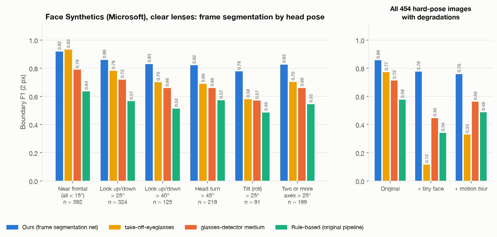

| Clear lenses, boundary F1 | n | **Ours** | take-off-eyeglasses | glasses-detector | Rule-based |
|---|---|---|---|---|---|
| Near frontal (all axes < 15°) | 392 | 0.921 | **0.934** | 0.791 | 0.638 |
| Look up / down > 25° | 324 | **0.861** | 0.784 | 0.721 | 0.568 |
| Look up / down > 40° | 125 | **0.832** | 0.703 | 0.661 | 0.516 |
| Head turn > 45° | 219 | **0.823** | 0.691 | 0.661 | 0.575 |
| Tilt > 25° | 91 | **0.780** | 0.582 | 0.572 | 0.488 |
| Two or more axes > 25° | 199 | **0.828** | 0.704 | 0.662 | 0.546 |
| **All hard poses** | 454 | **0.858** | 0.774 | 0.715 | 0.579 |
| All hard poses + tiny face | 454 | **0.778** | 0.119 | 0.448 | 0.343 |
| All hard poses + motion blur | 454 | **0.761** | 0.331 | 0.565 | 0.489 |

- **The lead on hard poses is not noise.** Paired bootstrap over the 454 hard-pose images, 95% interval of the gap in boundary F1: +0.084 [+0.071, +0.098] over take-off-eyeglasses, +0.143 [+0.133, +0.154] over glasses-detector and +0.279 [+0.266, +0.292] over the rule-based mask. This model scores higher on 74%, 95% and 98% of the images respectively.
- **The gap grows with difficulty.** From near frontal to a tilt beyond 25°, this model goes from 0.92 to 0.78, take-off-eyeglasses from 0.93 to 0.58 and glasses-detector from 0.79 to 0.57.
- **Where it is not ahead.** On near-frontal faces take-off-eyeglasses is slightly more accurate (gap −0.014 [−0.020, −0.007]); it was trained on 3D-rendered glasses that look much like these renders. With opaque lenses, where frame and lens are labelled together, glasses-detector is better (0.74 vs. 0.69, n = 2,164).
- **Caveats.** These are still synthetic images, just not ours. The labels contain only the frame and the tolerance is 2 px, so masks that are drawn thick lose points; this is why glasses-detector stays below 0.8 even on frontal faces here while it leads on real photos (§5.3). Face Synthetics images are not reproduced in this post: the dataset's research-use agreement does not allow redistribution.

Reproduce: download part 1 (`dataset_100000.zip.001`, 8.5 GB) from the [Face Synthetics repository](https://github.com/microsoft/FaceSynthetics), extract it as a stream (`bsdtar -xf - < dataset_100000.zip.001`), then

```bash
python training/eval_real.py prepare_fsynth --src <extracted>/dataset_100000 --name fsynth_p1 --out data/eval_cache
python training/eval_real.py run --cache data/eval_cache --data fsynth_p1 --perturb orig small mblur \
    --methods ours tog gd_medium rule --ckpt weights/frame_seg.pt --out reports/fsynth_p1
```

### 5.5 A real video

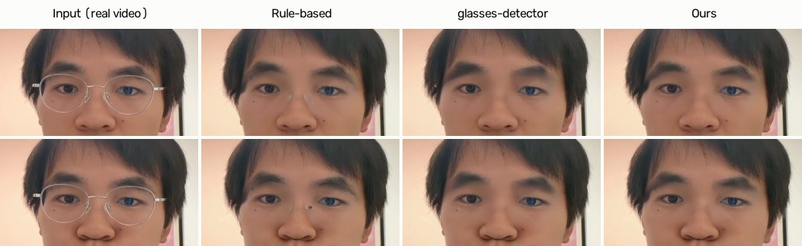

`input/example.mp4` is a public sample clip from the LivePortrait repository. All three masks remove the thin metal frame here; the rule-based mask leaves nose-pad remnants in some frames. In close-ups with thick rims, the default `--seg_margin_k 0.5` (mask margin proportional to the detected frame width) is what removes the faint outline that a fixed 2 px margin left behind.

## 6. Limitations

- **Tiny faces** (30–60 px in the source video) and the small-face part of dolly shots: residue stays high for every method; the inpainter only has a few dozen pixels to work with.
- **Real-image recall**: thin frames on real footage are sometimes partially missed (§5.3). Pseudo-label self-training on public real photos is the planned next step.
- **Extreme combined poses** (|yaw| > 50° together with |pitch| > 30°) are under-represented in training data.
- Sunglasses / dark lenses, lens reflections and lens refraction are out of scope (the lens interior is deliberately left unchanged).
- **Near-frontal accuracy**: on frontal Face Synthetics renders take-off-eyeglasses is slightly more precise (§5.4), and on frontal real photos glasses-detector has higher outline recall (§5.3). The advantage of this model is concentrated in hard poses, tiny faces and blur.
- Synthetic validation boundary F1 is 0.822; rimless frames (0.64) and faces under 80 px (0.65) pull it down.

## 7. Using it

See **[docs/USAGE.md](docs/USAGE.md)** for installation, commands and parameters. In short:

```bash
git clone https://github.com/yu0809/video-glasses-removal.git && cd video-glasses-removal
PYTHON=python3.12 bash setup.sh                 # venv, ProPainter, model downloads
source .venv/bin/activate
python remove_glasses.py -i input/example.mp4 --duration 2
```

The model weights (`weights/frame_seg.pt`, CC BY-NC-SA 4.0) are distributed as a [release asset](https://github.com/yu0809/video-glasses-removal/releases) and downloaded by `setup.sh`; without them the pipeline falls back to the rule-based mask. Long videos: `bash process_long.sh input/video.mp4` processes 60-second pieces and stitches them back together.

The evaluation details are in **[docs/EVAL_REPORT.md](docs/EVAL_REPORT.md)**, data sources and licences in **[docs/DATASETS.md](docs/DATASETS.md)**. Every chart in this post is generated by `docs/scripts/make_figures.py` and `docs/scripts/make_examples.py` from the evaluation outputs.

## 8. Repository layout

```
remove_glasses.py        pipeline entry point (detection, segments, masks, ProPainter, residue check, paste-back)
learned_mask.py          network mask: temporal alignment, hysteresis, adaptive margin, residue score
seg_model.py             FrameSegmenter inference wrapper (.pt / .onnx)
adaptive.py              rule-based mask (fallback)
process_long.sh          long videos in 60 s pieces
training/
  prepare_faces.py       face pool from images / videos / Arrow shards, with filtering
  repose/                LivePortrait re-posing, mesh re-projection, landmark transfer
  synth/                 3D glasses geometry, renderer, augmentations, pose sampler, previews
  model.py train.py dataset.py metrics.py
  evaluate.py eval_real.py eval_e2e.py make_test_videos.py baselines.py
docs/                    usage, evaluation report, data sources, figure scripts and images
weights/                 frame_seg.pt goes here (downloaded from Releases)
input/ output/           example clip / results
```

No datasets, face crops, test videos, training runs or third-party weights are included in this repository.

## Licence

- **Code**: MIT (see [LICENSE](LICENSE)).
- **Model weights**: **CC BY-NC-SA 4.0**, non-commercial only — they were trained on data that is licensed for non-commercial research (FFHQ, CelebAMask-HQ, AFLW2000-3D).
- **ProPainter** is used under the NTU S-Lab License 1.0, **non-commercial use only**. **LivePortrait** (MIT) depends on InsightFace detection models that are for non-commercial research only.
- The overall pipeline is therefore **for non-commercial use**.

## References

- Zhou, Li, Chan, Loy. *ProPainter: Improving Propagation and Transformer for Video Inpainting.* ICCV 2023. [github.com/sczhou/ProPainter](https://github.com/sczhou/ProPainter)
- Guo et al. *LivePortrait: Efficient Portrait Animation with Stitching and Retargeting Control.* arXiv:2407.03168, 2024. [github.com/KwaiVGI/LivePortrait](https://github.com/KwaiVGI/LivePortrait)
- Lyu, Wang, Xu. *Portrait Eyeglasses and Shadow Removal by Leveraging 3D Synthetic Data.* CVPR 2022. [github.com/StoryMY/take-off-eyeglasses](https://github.com/StoryMY/take-off-eyeglasses)
- Mantas. *glasses-detector* (Python package, MIT). [github.com/mantasu/glasses-detector](https://github.com/mantasu/glasses-detector)
- Karras, Laine, Aila. *A Style-Based Generator Architecture for Generative Adversarial Networks* (FFHQ). CVPR 2019. [github.com/NVlabs/ffhq-dataset](https://github.com/NVlabs/ffhq-dataset)
- Lee, Liu, Wu, Luo. *MaskGAN: Towards Diverse and Interactive Facial Image Manipulation* (CelebAMask-HQ). CVPR 2020. [github.com/switchablenorms/CelebAMask-HQ](https://github.com/switchablenorms/CelebAMask-HQ)
- Zhu, Lei, Liu, Shi, Li. *Face Alignment Across Large Poses: A 3D Solution* (300W-LP, AFLW2000-3D). CVPR 2016.
- Wood et al. *Fake It Till You Make It: Face Analysis in the Wild Using Synthetic Data Alone* (Face Synthetics). ICCV 2021. [github.com/microsoft/FaceSynthetics](https://github.com/microsoft/FaceSynthetics)
- Kartynnik, Ablavatski, Grishchenko, Grundmann. *Real-time Facial Surface Geometry from Monocular Video on Mobile GPUs* (MediaPipe Face Mesh). arXiv:1907.06724, 2019.
- Deng et al. *RetinaFace: Single-Shot Multi-Level Face Localisation in the Wild.* CVPR 2020.
- Yu et al. *BiSeNet: Bilateral Segmentation Network for Real-time Semantic Segmentation.* ECCV 2018.
- Cheng et al. *VideoReTalking: Audio-based Lip Synchronization for Talking Head Video Editing in the Wild.* SIGGRAPH Asia 2022 (sample talking-head clips used for smoke tests).
- Ronneberger, Fischer, Brox. *U-Net.* MICCAI 2015 · He et al. *Deep Residual Learning.* CVPR 2016 · Wightman. *PyTorch Image Models (timm).*
- Face detection, landmarks, parsing and head pose run through [uniface](https://github.com/yakhyo/uniface) (MIT).
- The 68-point mean face used to compute head pose from Face Synthetics landmarks is from [yinguobing/head-pose-estimation](https://github.com/yinguobing/head-pose-estimation) (MIT).
